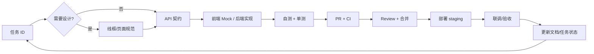

# 07 · 协作工作流

## 0. 端到端开发工作流（从设计到上线）



**每个任务的固定节奏：**

1. 从 `04-todos.md` 领取任务 ID；不清楚接口先读 `05-architecture.md`。
2. 需要设计？先看 `08-design-playbook.md` / 页面规范；不要边写边想 UI。
3. 接口没定？先改 `05-architecture.md` + OpenAPI；前端先用 Mock，不空等。
4. 实现 + 自测；后端 LLM 用 mock，前端覆盖 loading/empty/error/success。
5. 开 PR + 跑 CI；另一人 review；小步合并。
6. 合并后部署 staging；按验收标准逐项过。
7. 更新 `04-todos.md`（状态）、`05-architecture.md`（契约）、`06-file-tree.md`（结构）。

**每周节奏：**

| 时间 | 动作 |
|---|---|
| 周一到周五 | 每天 15 分钟站会；每天至少一次合并/部署 staging；阻塞当天提出 |
| 周日 | 30–45 分钟复盘：里程碑、风险、范围审计、下周分工 |
| 里程碑结束 | 逐项过退出标准；更新 `00-context.md`、`03-roadmap.md`、`04-todos.md` |

**阶段节奏：**

| 阶段 | 时间 | 重点 |
|---|---|---|
| M0 设计+骨架 | 11.4–11.7 | PRD、8 页线框、API v0、前后端骨架、CI |
| M1 纵向切片 | 11.8–11.14 | 文本闭环 + 部署 staging + DeepSeek 识图 spike |
| M2 功能完整 | 11.15–11.21 | 练习/统计/搜索/识图入口/错误态 |
| M3 稳定答辩 | 11.22–11.29 | Bug bash、种子数据、PPT、彩排 |

> 工作流的核心不是“流程好看”，而是：**接口先定、Mock 并行、每天可部署、文档随代码更新**。

## 1. 角色与决策权

| 事项 | 决定人 | 必须知会 |
|---|---|---|
| 前端实现/组件/样式 | 霹雳马桶 | 人机（涉及接口时） |
| 后端实现/数据库/AI | 人机 | 霹雳马桶（涉及契约时） |
| API 契约变更 | 两人共同确认 | 我想抓住风的影子（影响体验时） |
| 范围增减 | 两人共同确认 | 我想抓住风的影子 + 记录到 `01-project.md` / PRD |
| 部署/服务器 | 人机主导 | 霹雳马桶 |
| 产品设计/体验/优先级 | 霹雳马桶 + 人机 | 我想抓住风的影子（评审） |
| 最终答辩内容 | 两人共同 | 我想抓住风的影子可提意见 |

> 两人都是开发者，不存在“这是你的模块我完全不管”。**每人都要能跑起对方的项目**。

## 2. 沟通节奏

| 频率 | 形式 | 内容 | 时长 |
|---|---|---|---|
| 每天 | 站会（线上/当面） | 昨天做了什么、今天做什么、有没有阻塞 | 15 分钟 |
| 每周日 | 周复盘 | 里程碑进度、风险、下周计划、范围取舍 | 30–45 分钟 |
| 每个里程碑 | 验收会 | 逐项过退出标准；更新文档 | 45 分钟 |
| 按产品评审安排 | 产品走查 | 体验问题、优先级、答辩建议 | 按产品评审 |
| 随时 | 异步 | 接口变更、阻塞、需要对方决策 | 立即 |

**站会三问**：

1. 昨天完成了什么（对应任务 ID）？
2. 今天做什么（对应任务 ID）？
3. 有没有阻塞/需要对方做什么？

> 不要开“今天也很忙”的会。没有任务 ID 的进度等于没说。

## 3. Git 工作流（GitHub Flow）

两人项目，**不要用复杂 Git Flow**。用短分支 + PR + squash merge。

```text
main（保护，始终可运行/可部署）
  ↑ PR（1 人 review，CI 绿）
feat/frontend-question-list
fix/backend-sse-timeout
docs/update-api-contract
chore/ci-cache
```

### 3.1 分支规则

- 从 `main` 拉分支；分支寿命 ≤ 2 天，超过就拆小或先合一部分。
- 命名：`feat/<范围>-<简述>`、`fix/<范围>-<简述>`、`docs/...`、`chore/...`。
- 不允许直接 push `main`；`main` 开分支保护（至少要求 PR + CI）。
- 合并用 **squash merge**，保持 `main` 历史干净。
- 合并后删除远端分支。

### 3.2 Commit 规范（Conventional Commits）

```text
feat(frontend): 增加错题列表筛选
fix(backend): 修复 SSE 心跳导致连接断开
docs(agent): 更新 API 契约 v1
test(backend): 补充生成接口校验测试
chore(ci): 缓存 pnpm 依赖
refactor(frontend): 抽取 MarkdownRenderer
```

- 一个 commit 只做一件事；不要“顺手重构”。
- 提交前跑 lint/format；不要提交 `console.log`、调试代码、`.env`。
- 不在 commit message 里写“update”“fix bug”这种无信息内容。

### 3.3 PR 要求

**PR 大小**：尽量 < 400 行 diff；超过就拆。前端页面 + 后端接口可以分成两个 PR，用契约连接。

**PR 模板**：

```markdown
## 做了什么
- 

## 为什么
- 

## 怎么验证
- [ ] 本地运行
- [ ] 单测/构建
- [ ] 手动路径：...

## 接口/数据变更
- [ ] 无
- [ ] 有（已更新 05-architecture.md / OpenAPI）

## 截图（UI 改动）
```

**合并条件**：

1. CI 绿（lint/typecheck/test/build）。
2. 另一个人 review 过（至少看 diff；小改动可口头确认后评论“LGTM”）。
3. 没有未解决的 `request changes`。
4. 文档已同步（如涉及契约/结构）。

### 3.4 Code Review 清单

Reviewer 只看这几项，不要变成风格争吵：

- [ ] 逻辑是否正确？边界条件（空、超长、重复、未登录、越权）是否处理？
- [ ] 是否调用了真实 LLM 在测试里？测试是否稳定？
- [ ] 是否有密钥/敏感信息进入代码/日志？
- [ ] API 字段/错误码是否与 `05-architecture.md` 一致？
- [ ] 数据库查询是否有 N+1/全表扫描/缺索引？
- [ ] 前端是否有 loading/empty/error 三态？AI 失败是否白屏？
- [ ] 是否引入了不必要的新依赖？
- [ ] 命名/目录是否符合 `06-file-tree.md`？

> 风格问题交给 formatter/linter，不要在人肉 review 里吵。

## 4. API 变更协议（最重要）

前后端并行开发，**接口变更不受控 = 联调灾难**。

### 4.1 变更流程

1. 提出方在 PR/Issue 写清：改哪个接口、字段、为什么、影响谁。
2. 两人确认后，**先改 `05-architecture.md`**，再改代码。
3. 后端更新 Pydantic schema/OpenAPI；前端重新生成类型或手改 `api/types.ts`。
4. 在 PR 描述里写“BREAKING”或“compatible”。
5. 联调时用 OpenAPI diff 检查字段是否一致。

### 4.2 兼容性原则

- 加字段：兼容；前端忽略未知字段。
- 删字段/改类型/改路径：破坏性；必须两人确认 + 同一天合并前后端。
- 错误码：只加不改；前端按 `code` 分支，不按 message。
- 分页/时间/ID 格式：全局统一，不要每个接口一套。

### 4.3 Mock 策略

- 11.7 前：前端用 Mock（MSW 或 Vite mock）覆盖 P0 接口。
- 11.8 起：后端提供 staging；前端可切真实接口。
- 后端未完成的接口：前端继续用 Mock，不空等。
- Mock 数据放 `frontend/src/api/mocks/`，字段与契约一致。

## 5. 环境与本地开发

### 5.1 首次配置（两人都要跑通）

```bash
# 前端
cd frontend
pnpm install
cp .env.example .env
pnpm dev

# 后端
cd backend
uv sync
cp .env.example .env
uv run alembic upgrade head
uv run uvicorn app.main:app --reload --port 8000

# 本地 MySQL（可选）
docker compose -f deploy/docker-compose.dev.yml up -d
```

### 5.2 环境约定

| 环境 | 前端 | 后端 | 数据库 | 用途 |
|---|---|---|---|---|
| local | `pnpm dev` :5173 | uvicorn :8000 | SQLite | 日常开发 |
| local-mysql | `pnpm dev` | uvicorn :8000 | Docker MySQL | 验证兼容性 |
| staging | 部署地址 | 部署 API | MySQL | 11.14 起每天验证 |
| demo | 部署地址 | 部署 API | MySQL | 11.29 答辩 |

- `.env` 不提交；`.env.example` 必须保持最新。
- LLM 默认 DeepSeek：`LLM_BASE_URL=https://api.deepseek.com`、`LLM_MODEL=deepseek-flash`、`LLM_VISION_MODEL=deepseek-flash`；`deepseek-v4-pro` 不支持图片。
- 新环境变量加入时，同时更新 `.env.example` + `05-architecture.md` 第 11 节 + 部署 README。
- 本地数据库重置：删除 `backend/data/app.db` 后 `alembic upgrade head` + seed。

### 5.3 依赖版本

- 前端：`pnpm-lock.yaml` 提交；Node 20/22 LTS。
- 后端：`uv.lock` 提交；Python 3.13（`.python-version`）。
- 新依赖必须说明理由；不要为了一个小功能引入大库。
- 关键依赖升级单独 PR，不和功能混在一起。

## 6. 测试策略

### 6.1 测试金字塔（按 25 天现实裁剪）

| 层 | 工具 | 覆盖 | 何时跑 |
|---|---|---|---|
| 后端单元 | pytest | prompt 解析、校验、auth、统计口径 | 每次 PR |
| 后端 API | pytest + httpx | 登录、CRUD、分析/生成（mock LLM）、权限 | 每次 PR |
| 前端单元 | Vitest | utils、store、MarkdownRenderer | 每次 PR |
| 前端组件 | Vue Test Utils | 关键表单/题卡/错误态 | 每次 PR（少量） |
| E2E | Playwright | 1 条主流程 + 1 条失败路径 | 合并前/每天 |
| 手动 | 清单 | 演示路径、浏览器/分辨率、异常 | 每天/演示前 |

### 6.2 必须有的测试

- 登录成功/失败/过期 token。
- 创建错题：必填校验、超长、未登录。
- 分析/生成：LLM 返回合法 JSON、非法 JSON、超时、3 题不足。
- 权限：用户 A 不能读/删用户 B 的错题。
- 统计：0 练习、全对、全错、混合。
- 前端：Markdown/LaTeX 渲染、401 跳转、生成失败重试。

### 6.3 不做的测试

- 不调真实 LLM 的自动化测试（不稳定/花钱）；用 mock/fixture。
- 不为每个小组件写快照测试；把时间留给主流程。
- 不追求 100% 覆盖率；P0 路径覆盖优先。

## 7. 部署流程

### 7.1 环境

- **staging**：11.14 前必须有；每次合并 `main` 自动/手动部署。
- **demo**：11.28 冻结；只修 P0 bug；部署前备份。
- 服务器/平台在 11.7 前选定；不要等到 11.13。

### 7.2 部署步骤（目标）

```bash
# 服务器
git pull
docker compose -f deploy/docker-compose.yml up -d --build
docker compose -f deploy/docker-compose.yml ps
curl -f https://<host>/api/v1/health
```

- 数据库迁移：`docker compose exec api alembic upgrade head`。
- 回滚：保留上一个镜像 tag；DB 迁移必须向前兼容（先加字段，再改代码）。
- 密钥：服务器 `.env`，权限 600；不写进 compose 文件。
- 部署后检查：登录、创建、生成、列表、SSE、上传。

### 7.3 演示前冻结

- 11.28 起只修 P0/P1，不加功能。
- 冻结后每次改动都要重新跑演示脚本。
- 保留一个“已知可用”的 commit/tag，出问题可回滚。

## 8. Bug 分级与处理

| 级别 | 定义 | 处理 |
|---|---|---|
| P0 | 演示路径中断、数据丢失、安全问题 | 立即修；当天必须验证 |
| P1 | 明显影响体验但不阻断演示 | 11.28 前修；排进当天/次日 |
| P2 | 边缘情况、样式小问题 | 记录，演示后处理 |
| P3 | 建议/未来功能 | 放 backlog |

Bug 记录格式：

```text
[P0] 生成后列表不刷新
复现：登录 → 创建 → 生成 → 返回列表
期望：看到新错题
实际：列表为空，刷新后出现
环境：Chrome 120 / staging
负责人：
状态：
```

> 不要用“偶现”当结论；记录复现步骤、环境、日志/截图。

## 9. 会议与产品评审协作

### 9.1 与产品评审（我想抓住风的影子）

- 我想抓住风的影子不参与开发，但会定期走查、提意见、同步风险。
- 产品设计由霹雳马桶 + 人机共同负责；评审意见不替代两人的设计决策。
- 每次走查前，准备好：演示地址、演示账号、本次重点、已知问题。
- 反馈统一记录到 `docs/product/README.md` 的“反馈记录”，并标注：接受/延期/拒绝 + 原因。
- 不要当场承诺所有反馈；先评估是否在演示路径上。

### 9.2 周复盘议程（30 分钟）

1. 里程碑进度（对照 `03-roadmap.md` 退出标准）— 10 分钟
2. 本周完成/未完成（任务 ID）— 5 分钟
3. 风险与阻塞（`09-risks.md`）— 5 分钟
4. 下周计划与分工— 5 分钟
5. 文档/契约需要同步的内容— 5 分钟

## 10. Definition of Done（再次强调）

- [ ] 代码可运行，主流程手动验证过。
- [ ] 有测试（按 6.2 的必要项）。
- [ ] lint/typecheck/build 通过。
- [ ] API/数据模型/页面规范文档同步。
- [ ] 另一人 review。
- [ ] 没有密钥/调试代码。
- [ ] 部署环境（或本地完整流程）验证。

## 11. 文档维护

- 每次 PR 检查：是否影响 `05-architecture.md`、`06-file-tree.md`、`04-todos.md`。
- 每周日更新 `03-roadmap.md` 的“当前进度”。
- 每个里程碑更新 `00-context.md` 的“当前阶段/下一步”。
- 不可逆决策写 `docs/adr/`；不要只留在聊天记录。
- 文档中的日期、任务 ID、链接必须可点/可查；不要写“大概”“可能”。

## 12. 工具清单

| 用途 | 工具 | 备注 |
|---|---|---|
| 代码托管/CI | GitHub + Actions | 仓库已建 |
| 任务板 | GitHub Issues/Projects | `04-todos.md` 做快照 |
| 设计 | Figma / 即时设计 / Penpot | 选一个，团队统一 |
| 流程图 | Excalidraw / Mermaid | Mermaid 进文档 |
| API 调试 | Bruno / Postman / curl | Bruno 可存集合进仓库（可选） |
| 数据库 | DBeaver / TablePlus | 本地看数据 |
| 截图/录屏 | OBS / Windows 录屏 | 演示备份 |
| 沟通 | 微信/飞书 | 重要决定回写文档 |
