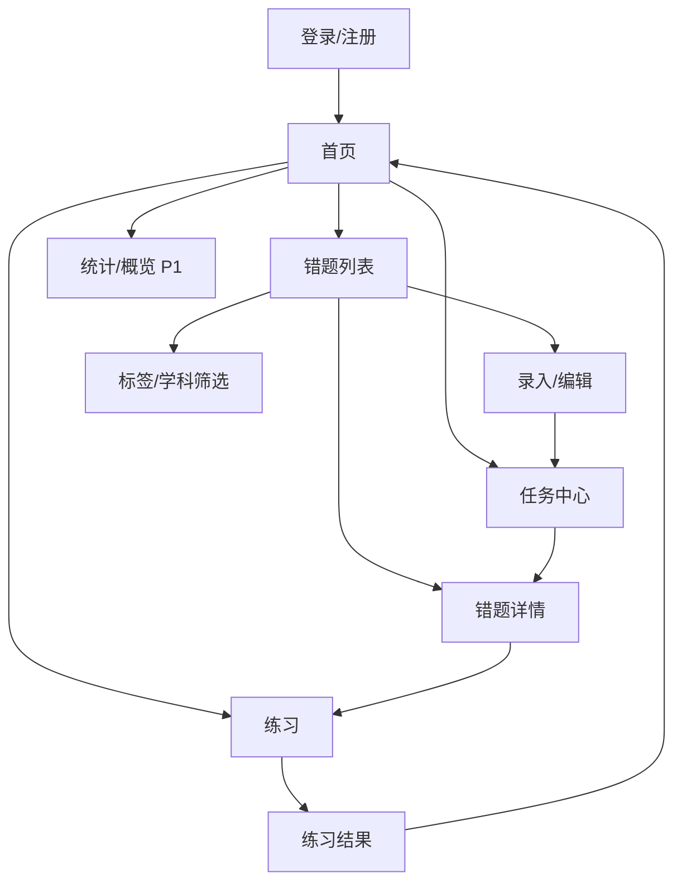
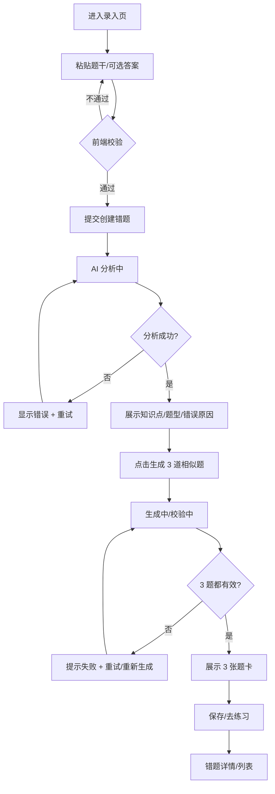
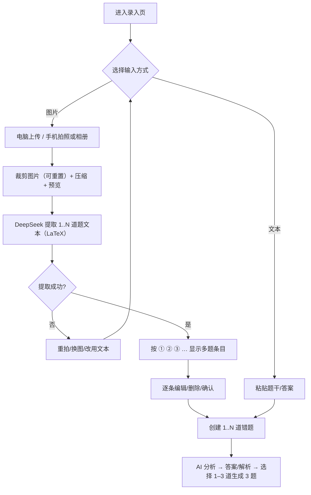

# 08 · 设计环节操作手册

> 这份文档解决三个问题：**设计到什么程度可以停、按什么顺序做、怎么保证设计能直接变成代码**。
> 你不需要成为专业设计师；你需要的是在 11.7 前产出“足够开发、足够演示、足够讲清楚”的设计。

## 0. 原型图是否必要？

**必要，但不是“画得漂亮”那种必要。** 对这个项目，原型的价值是：

1. **对齐范围**：两个人对“录入后发生什么”有同一张图，少吵架。
2. **提前暴露 AI 状态**：等待、失败、重试、部分成功、空数据，这些不画出来，开发时一定漏。
3. **让前端有依据**：页面/组件/间距/状态有参考，不用每天问“这里长什么样”。
4. **让产品评审能提意见**：可点击原型比口头描述更容易发现问题。
5. **支撑答辩**：原型截图可以直接进 PPT。

**最小集（建议）：**

| 产物 | 数量 | 是否必须 |
|---|---|---|
| 一页纸 PRD | 1 | 必须 |
| 8 页线框图（灰度） | 7 | 必须 |
| 5–6 页高保真关键页 | 5–6 | 有时间就做 |
| 核心闭环可点击原型 | 1 条 | 有时间就做 |
| 3 人可用性测试 | 3 人 | 必须（11.7） |

**不需要**：完整设计系统、像素级还原、复杂动效、暗色模式、所有边缘页面。
**如果只剩 1 天**：PRD + 3 页线框（录入、详情/生成、练习）+ 状态标注，其余用 Arco 默认样式。

> 结论：**做原型，但做“够开发”的原型，不做作品集**。11.7 后不再大改设计。

## 1. 设计阶段的目标

11.7 24:00 前，设计只需要达到：

1. 能讲清用户从进入产品到完成核心闭环的每一步。
2. 每个页面能映射到组件、API、状态。
3. 覆盖 AI 产品特有的状态：等待、失败、重试、部分成功、空数据。
4. 产品评审能在 5 分钟内理解产品在做什么。
5. 前端能照着开始写，不需要每天问“这里长什么样”。

**不需要**：完整品牌系统、插画、复杂动画、暗色模式、像素级高保真、所有边缘页面。

## 2. 设计原则

| 原则 | 含义 | 反例 |
|---|---|---|
| 演示路径优先 | 只设计 11.29 会走到的页面和状态 | 花两天设计设置页 |
| 真实内容设计 | 用真实错题、公式、长文本做稿 | 用 “Lorem ipsum” 导致上线溢出 |
| 状态优先 | 每个异步动作都有 loading/empty/error/success | 只画“成功态” |
| 少页面少层级 | 核心闭环 ≤ 5 步 | 录入要经过 4 个弹窗 |
| 用 Arco 组件 | 设计稿尽量用 Arco 已有组件 | 设计一个 Arco 没有的复杂表格 |
| 移动端重新排 | 不是把桌面缩小 | 把 3 列卡片压成 3 列小卡片 |
| 可访问性 | 对比度、焦点、键盘、标签 | 浅灰字 + 白底 |
| 够用就停 | 11.7 后不再大改设计 | 11.10 还在换配色 |

## 3. 四天设计冲刺（11.4–11.7）

| 日期 | 时间盒 | 产出 | 完成标志 |
|---|---|---|---|
| 11.4 | 2h | PRD-lite、P0/P1/P2、非目标 | 两人能一句话说清产品 |
| 11.4 | 1h | 核心闭环、页面清单 | 闭环 ≤ 5 步 |
| 11.5 | 2h | sitemap + 3 条流程 | 每条流程有页面/接口/错误分支 |
| 11.5 | 2h | 8 页线框图 | 灰度、无美化、能讲 |
| 11.6 | 2h | 设计 tokens + 组件清单 | 前端能建样式文件 |
| 11.6 | 2h | 5–6 页高保真 + 可点击原型 | 核心闭环可点 |
| 11.7 | 1.5h | 3 人可用性测试 | 记录 blocker/major |
| 11.7 | 1h | 修正 + 交接 | 设计稿/规范/API 映射齐全 |

> 如果只有 1 天：只做 **PRD 一页 + 核心闭环 + 3 页线框（录入、详情/生成、练习）**。其余用 Arco 默认样式。

## 4. Step 1：PRD-lite（45 分钟）

填 `docs/product/01-prd-lite.md`，只写一页：

- 一句话产品定义
- 目标用户（大学理科生）+ 场景
- 用户的问题（3 个）
- 现有替代方案 + 不足
- 核心闭环（5 步以内）
- P0/P1/P2
- 非目标
- 成功指标（3 个以内）
- 最大风险（3 个）

**判断标准**：一个没听过项目的人读完，能说出“给谁、解决什么、怎么用、先做什么”。

## 5. Step 2：信息架构（IA）

### 5.1 页面清单（建议 8 个）

| 页面 | 路由 | 作用 | 优先级 |
|---|---|---|---|
| 登录/注册 | `/login` | 进入产品 | P0 |
| 首页 | `/` | 去录入/练习/任务中心 | P0 |
| 错题列表 | `/questions` | 找错题、筛选、搜索 | P0 |
| 录入/编辑 | `/questions/new` | 文本/图片录入 + 三种题型编辑 + 保存 | P0 |
| 任务中心 | `/tasks` | 录入记录、队列状态、失败重试、草稿行 | P0 |
| 错题详情 | `/questions/:id` | 看分析、生成题、去练习 | P0 |
| 练习 | `/practice/:id?` | 逐题作答、计时、看解析 | P0 |
| 统计/概览 | `/stats` | 正确率、趋势、薄弱点 | P1 |
| 设置 | `/settings` | 账号/退出（可极简） | P1 |

### 5.2 导航结构

```text
侧边栏（桌面）                 顶栏
├─ 首页/概览                   ├─ 页面标题
├─ 错题本                     ├─ 搜索（列表页）
│   ├─ 全部错题                ├─ 用户菜单/退出
│   └─ 标签/学科
├─ 任务中心
├─ 练习
├─ 统计（P1）
└─ 设置
```

- 层级不超过 2 级；列表/详情用路由，不用层层弹窗。
- 录入用独立页面（表单长、需要 AI 结果区域），不要用小组件弹窗。
- 移动端：底部导航 4 项（首页、错题、练习、任务中心）+ 悬浮“录入”。

### 5.3 Sitemap 示例



## 6. Step 3：核心用户流程（工作流设计）

### 6.1 三条必须画的流程

| 流程 | 起点 | 终点 | 关键分支 |
|---|---|---|---|
| A 核心闭环 | 首页/录入 | 保存 3 道生成题 | 分析失败、生成失败、部分题无效 |
| B 练习闭环 | 列表/详情 | 练习结果 + 统计更新 | 未作答、提交失败、重复提交 |
| C 薄弱点复习 | 首页/统计 | 筛选出薄弱知识点 → 练习 | 无数据、筛选无结果 |

### 6.2 流程 A 示例



### 6.2b 图片录入分支（大学理科重点）



**设计要点**：

- 电脑端：拖拽/点击上传；手机端：拍照、相册两个明确入口。
- 图片先裁剪/预览再提交；支持重置原图/删除/重拍。
- 提取结果按 ① ② ③ … 条目展示，逐条可编辑；旁边保留原图对照。
- 当前阶段只提取文字/公式；含图题提示“目前仅提取文字”，生成题以纯文本变体为主。
- 失败：重拍/换图/直接粘贴文本；多题部分失败可重试缺失条目；不要只弹“识别失败”。

### 6.3 AI 生成状态机（必须设计）

| 状态 | UI | 用户可做什么 | 失败怎么办 |
|---|---|---|---|
| idle | 空状态 + “开始分析” | 编辑题干 | — |
| cropping | 图片裁剪器 + 重置 | 裁剪/重置/确认 | 重拍/换图/改文本 |
| uploading | 上传进度 | 等待/取消 | 重拍/换图 |
| extracting | 提取进度 + 原图 | 等待/取消 | 重拍/换图/改文本 |
| confirming_items | ① ② ③ … 多题条目 | 逐条编辑/删除/确认 | 重试缺失/改文本 |
| submitting | 按钮 loading + 禁用 | 等待/取消（可选） | 网络错误提示 |
| analyzing | 阶段进度 + 骨架屏 | 等待/取消 | 重试分析 |
| analyzed | 分析卡片 + 答案/解析 + 题目选择 | 查看/编辑/选择生成 | — |
| generating | 3 个题卡骨架 + 阶段文案 | 等待/取消 | 重试生成 |
| validating | “正在校验题目质量…” | 等待 | 自动重试 1 次 |
| partial | 已生成的题卡 + 失败提示 | 重试缺失/重新生成 | 重试 |
| success | 3 张完整题卡 | 保存/练习/重新生成 | — |
| error | 错误说明 + 重试按钮 | 重试/返回编辑 | 保留输入 |

**文案要点**：告诉用户“现在在做什么、大概多久、失败了怎么办”。不要只转圈。

### 6.4 工作流设计检查

- 每一步是否有明确的主按钮？
- 失败是否保留用户输入？
- 是否有取消/返回？返回会不会丢数据？
- 重复点击是否会产生重复数据？
- 刷新页面会怎样？
- 没有数据时页面是什么样？
- 用户能不能在 3 分钟内走完？

## 7. Step 4：线框图（8 页）

### 7.1 要求

- 灰度、无颜色、无插画；重点是布局/层级/操作。
- 用真实内容：一道真实大学理科错题（高数/线代/大学物理，含公式或图）、一段长解析、一个空账号。
- 每页标注：页面目的、主操作、组件、状态、调用接口。
- 先画核心闭环 4 页：录入、详情/生成、练习、统计；再补登录/列表/首页。

### 7.2 每页必须标注

```text
页面：
目的：
主操作：
布局（区域）：
组件：
数据/API：
状态：loading / empty / error / success
交互：
验收标准：
```

### 7.3 线框图检查清单

- [ ] 1366×768 下首屏能看到主操作。
- [ ] 长题干/公式不会撑破布局。
- [ ] 图片录入页能同时看到上传区、原图预览、可编辑识图结果。
- [ ] 手机拍照/相册入口清晰；失败能改文本。
- [ ] 列表有空状态、筛选无结果状态。
- [ ] 详情页能同时看到原题、分析、生成题，不用来回跳。
- [ ] 练习页一次只聚焦一道题；答案/解析默认折叠。
- [ ] 统计页没有数据时不是空白图表。
- [ ] 每个错误都有“下一步”按钮。

## 8. Step 5：设计系统（tokens + 组件）

### 8.1 Tokens（建议值，按 Arco 调整）

| 类别 | Token | 建议 |
|---|---|---|
| 主色 | `--color-primary` | Arco 蓝 `#165DFF` 或更稳的靛蓝 |
| 成功 | `--color-success` | `#00B42A` |
| 警告 | `--color-warning` | `#FF7D00` |
| 错误 | `--color-danger` | `#F53F3F` |
| 背景 | `--color-bg` | `#F7F8FA` / 暖白 `#FAFAF8` |
| 卡片 | `--color-surface` | `#FFFFFF` |
| 主文字 | `--color-text-1` | `#1D2129` |
| 次文字 | `--color-text-2` | `#4E5969` |
| 弱文字 | `--color-text-3` | `#86909C` |
| 边框 | `--color-border` | `#E5E6EB` |
| 字体 | `--font-sans` | `Inter, "Noto Sans SC", "PingFang SC", "Microsoft YaHei", sans-serif` |
| 字号 | `--text-xs/sm/base/lg/xl/2xl` | 12/14/16/18/20/24 |
| 间距 | `--space-1..8` | 4/8/12/16/24/32/48/64 |
| 圆角 | `--radius-sm/md/lg` | 6/8/12 |
| 阴影 | `--shadow-card` | `0 1px 2px rgba(0,0,0,.04), 0 4px 12px rgba(0,0,0,.04)` |
| 断点 | `--bp-sm/md/lg` | 375/768/1200 |

### 8.2 组件清单

| 组件 | 用途 | 状态 |
|---|---|---|
| `AppShell` | 侧边栏 + 顶栏 + 内容区 | 桌面/移动 |
| `PageHeader` | 标题 + 描述 + 主操作 | 默认 |
| `StatCard` | 数字 + 标签 + 趋势 | 默认/空/loading |
| `QuestionCard` | 题干摘要 + 标签 + 时间 | 默认/hover/选中 |
| `TagList` | 知识点/自定义标签 | 溢出 +N |
| `FilterBar` | 学科/标签/搜索 | 默认/展开/清空 |
| `AIGenerationPanel` | 阶段进度 + 题卡列表 | idle/loading/success/error/partial |
| `StreamStatus` | 当前阶段文案 + 进度 | 各阶段 |
| `MarkdownRenderer` | Markdown + LaTeX + 代码 | 默认/超长 |
| `EmptyState` | 无数据 | 带主操作 |
| `ErrorState` | 错误 + 重试 | 带错误码 |
| `LoadingSkeleton` | 骨架屏 | 列表/详情/题卡 |
| `ConfirmDialog` | 删除/重新生成确认 | 默认 |
| `PracticeCard` | 题干 + 作答 + 计时 | 未答/已答/揭晓 |
| `ResultFeedback` | 对/错 + 解析 | 正确/错误 |
| `SearchInput` | 搜索 + 防抖 | 默认/加载 |
| `Pagination` | 分页 | 默认/禁用 |

### 8.3 状态规范

每个交互组件至少定义：

- default / hover / focus / active / disabled
- loading / error / empty（适用时）
- 移动端布局

### 8.4 Arco 使用建议

- 优先用 Arco 的 `Button/Form/Table/Card/Tag/Modal/Message/Upload/Skeleton/Empty/Result`。
- 用官方 Vite 插件做按需引入和主题；不要全量引入。
- 主题优先用 CSS 变量；少用深层选择器覆盖，避免升级/样式冲突。
- Arco Vue 没有现成的聊天/流式消息组件：`AIGenerationPanel` 需要自建，设计稿要简单。
- 图表用 ECharts；Arco 不自带图表。
- 不要同时引入 Tailwind 和 Arco 的 reset 而不处理冲突；二选一或严格 scoped。
- 暗色模式不做；把 token 设计成可扩展即可。

## 9. Step 6：高保真与可点击原型

### 9.1 只做 5–6 页

1. 登录
2. 首页/概览
3. 录入 + 分析
4. 详情 + 生成结果
5. 练习
6. 统计

### 9.2 原型要能点通

- 核心闭环：登录 → 录入 → 分析 → 生成 → 保存 → 练习 → 统计。
- 至少一条失败分支：生成失败 → 重试。
- 不要做无意义的页面跳转动画；原型是给开发/测试看的，不是宣传片。

### 9.3 工具

| 用途 | 推荐 | 备注 |
|---|---|---|
| 线框/流程 | Excalidraw、纸笔 | 最快 |
| 高保真 | Figma、即时设计、MasterGo、Penpot | 选团队能访问的 |
| Arco 资源 | Arco 官方 Figma 组件库（如有） | 减少设计与实现差异 |
| 可点击原型 | Figma/即时设计 | 只连核心闭环 |
| 图示 | Mermaid（进文档）、Excalidraw（进 PPT） | 两种都准备 |

## 10. Step 7：可用性测试（11.7）

### 10.1 找 3 个人

- 产品评审：我想抓住风的影子
- 一位同学（目标用户最好）
- 搭档（换视角）

### 10.2 5 个任务（不要提示）

1. 登录后录入一道错题。
2. 找到 AI 分析出的知识点。
3. 生成并保存 3 道相似题。
4. 开始练习并提交一道题。
5. 找到自己最薄弱的知识点。

### 10.3 记录

| 字段 | 内容 |
|---|---|
| 任务 | 1–5 |
| 完成 | 是/否/需要帮助 |
| 用时 | 秒 |
| 卡点 | 在哪一步犹豫/点错 |
| 原话 | 用户说了什么 |
| 严重度 | blocker / major / minor |

**只修 blocker/major**；minor 记录，11.7 后不再大改。

## 11. Step 8：设计交接（给前端/后端）

### 11.1 页面规范模板

```text
页面名称：
路由：
目的：
主操作：
布局：
组件：
数据来源（API）：
字段映射：
状态：
  - loading：
  - empty：
  - error：
  - success：
交互：
校验规则：
权限：
验收标准：
设计稿链接：
```

### 11.2 交接检查

- [ ] 每个页面有路由和主操作。
- [ ] 每个数据元素能对应到 API 字段。
- [ ] 每个异步动作有 loading/error/retry。
- [ ] 每个列表有 empty/filter-empty。
- [ ] 每个删除有确认。
- [ ] 长文本/公式/图片有约束。
- [ ] 移动端布局说明。
- [ ] 设计稿与 Arco 组件一致；自定义组件注明原因。
- [ ] 前端/后端都看过并提问。

## 12. 常见设计坑（这个项目特别容易踩）

1. **只画成功态**：AI 产品 30% 时间在等待/失败；不设计这些状态，上线一定白屏。
2. **用假数据设计**：真实数学题有公式、长题干、图片；用 Lorem ipsum 一定溢出。
3. **生成结果卡片太密**：题干、答案、解析、标签全展开，用户不知道看哪；答案/解析默认折叠。
4. **没有“重新生成”**：AI 一次生成不理想是常态；没有重试，用户只能删了重来。
5. **没有取消**：长请求不能取消，用户以为卡死。
6. **统计页堆图表**：0 数据时图表空白；先做 4 个数字 + 薄弱点列表。
7. **移动端最后做**：Arco 桌面组件直接压到手机不能用；至少核心三页重新排。
8. **设计稿用了 Arco 没有的组件**：开发成本翻倍；先用 Arco 组件，再做少量自定义。
9. **颜色/字号太多**：3 级文字 + 1 个主色 + 语义色足够。
10. **对比度不足**：投影仪上浅灰字看不见；正文对比度 ≥ 4.5:1。
11. **过度动画**：演示时卡顿；只保留必要的状态过渡。
12. **没有 API 映射**：设计稿无法落地；每个数据块标注来源。
13. **忽略 1366×768**：实验室投影常见分辨率；首屏主操作不能被挤下去。
14. **把“AI 分析”做成黑盒**：至少展示“正在分析知识点/正在生成/正在校验”的阶段。
15. **设置页/个人资料做太重**：演示路径用不到；极简即可。

## 13. 设计评审清单（11.7 用）

- [ ] **可读性**：题干/公式/答案/解析在 1366×768 和 375px 下清晰；长公式可横向滚动，不截断关键信息。
- [ ] **整体流畅**：主操作路径 ≤ 3 步；每页一个主操作；状态反馈及时，减少无意义跳转/弹窗。
- [ ] 3 分钟能讲完核心闭环。
- [ ] 每个页面只有一个主操作。
- [ ] 每个异步动作有 loading/success/error。
- [ ] 每个列表有 empty/filter-empty/loading/error。
- [ ] 每个删除/重新生成有确认。
- [ ] 每个 AI 失败有重试/取消。
- [ ] 375 / 768 / 1366 / 1920 四档检查过。
- [ ] 真实长题干 + 公式 + 图片检查过。
- [ ] 对比度/焦点/键盘/标签检查过。
- [ ] 设计元素能映射到 Arco 组件。
- [ ] 每个数据块能映射到 API。
- [ ] 没有 P2 功能混进 P0。
- [ ] 产品评审/搭档看过并记录反馈。

## 14. 设计到代码的映射

| 设计产物 | 代码落点 |
|---|---|
| 颜色/字号/间距 tokens | `frontend/src/styles/tokens.css` + Arco 主题 |
| 页面 | `frontend/src/views/*.vue` + `router` |
| 组件 | `frontend/src/components/<领域>/*.vue` |
| 状态 | `stores` / `composables` / 页面局部 state |
| API 映射 | `frontend/src/api/*.ts` |
| 校验规则 | 前端表单规则 + 后端 Pydantic |
| 验收标准 | 测试用例 + 手动清单 |
| 流程分支 | 页面路由/条件渲染/错误组件 |

## 15. 答辩与演示准备（设计视角）

### 15.1 7 分钟演讲结构（10–12 页）

1. 问题与用户痛点（1 页）
2. 现有方案不足（1 页）
3. 我们的闭环（1 页）
4. 关键界面/演示预告（1–2 页）
5. 技术架构（1 页）
6. AI 流水线与质量校验（1–2 页）
7. 难点与解决（1 页）
8. 数据与效果（1 页）
9. 团队分工与工程流程（1 页）
10. 未来规划（1 页）

### 15.2 3 分钟演示脚本

```text
0:00–0:30 登录，展示首页数据
0:30–1:10 打开一道大学理科种子错题（图片或文本），展示识图/AI 分析（知识点/错误原因）
1:10–1:50 生成 3 道相似题，展示题卡/答案折叠
1:50–2:30 进入练习，作答、看解析、提交
2:30–3:00 回到统计，指出薄弱知识点，收尾
```

- 不要现场输入长题干；用预置数据。
- 不要点遍所有功能；只走主闭环。
- 准备失败兜底：缓存结果/录屏/截图。
- 提前在演示机器/投影分辨率上走一遍。

### 15.3 评审可能问的问题

| 问题 | 回答要点 |
|---|---|
| 为什么不用 SpringBoot/langchain4j？ | 技术栈已确认；Python/FastAPI 更适合 LLM 接入、异步流式、25 天交付；docx 是早期申报材料 |
| 为什么不做 OCR？ | 独立 OCR 对公式/图表/手写体弱；DeepSeek `deepseek-flash` 多模态直读图文，结果可编辑 + 文本兜底 |
| 如何保证生成题质量？ | JSON schema + 校验 + 去重 + 禁止图片依赖 + 人工抽检；可选二次判分 |
| 生成题答案错了怎么办？ | 校验/重试/用户反馈/重新生成；不宣称 100% 正确 |
| 创新点是什么？ | 不是“AI 出题”，而是“生成 + 校验 + 练习 + 薄弱点”的闭环 |
| 和作业帮/小猿搜题的区别？ | 他们偏“搜答案”，我们偏“同类题练习 + 掌握度” |
| 知识图谱呢？ | MVP 用标签 + 学科；图谱是未来规划，不硬吹 |
| 数据隐私？ | 密钥服务端；不训练；最小化日志；可删除 |
| 两人怎么分工？ | 前端/后端主责 + 设计/部署/测试共担；PR/CI/文档记录 |

## 16. 设计阶段的停止条件

满足以下条件就停止设计，进入开发：

- [ ] PRD-lite 一页完成。
- [ ] 8 页线框完成，核心 4 页有状态标注。
- [ ] 3 条流程 + AI 状态机完成。
- [ ] tokens + 组件清单完成。
- [ ] 5–6 页高保真/可点击原型完成（时间不够可只用线框）。
- [ ] 3 人可用性测试完成，blocker 已修。
- [ ] 页面规范 + API 映射交接给前端/后端。
- [ ] 两人对 P0 范围无异议。

> 之后只做“开发中发现必须补”的小设计，不再开新的大设计。
