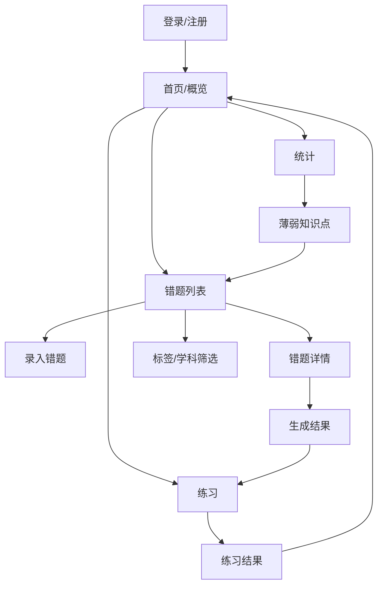
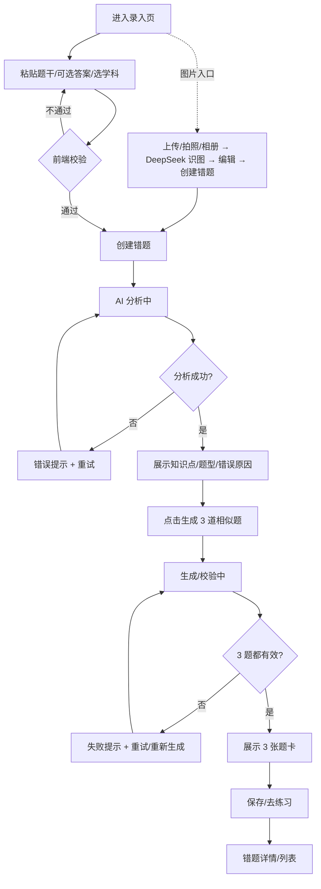
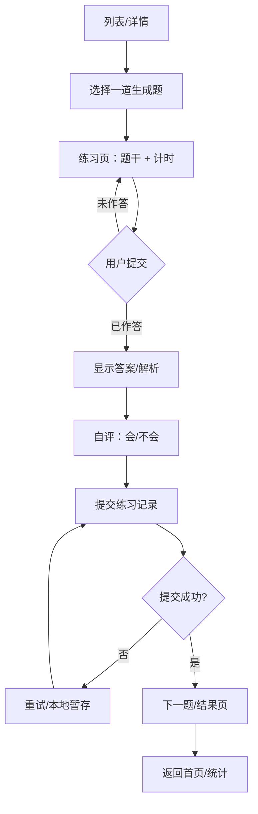
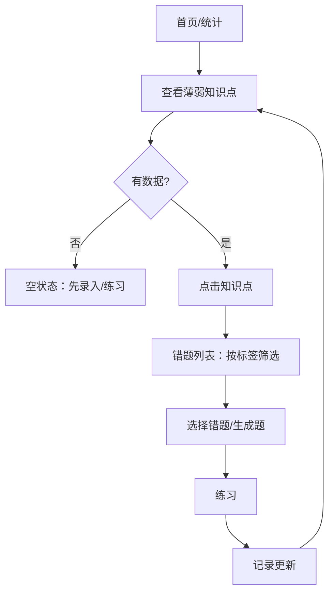

# 02 · 信息架构与流程

> 目标：把“产品闭环”翻译成页面、路由、跳转和状态。设计阶段只需覆盖 P0 页面。

## 1. 页面清单

| 页面 | 路由 | 作用 | 主操作 | 优先级 |
|---|---|---|---|---|
| 登录/注册 | `/login` | 进入产品 | 登录/注册 | P0 |
| 首页/概览 | `/` | 看数据、去录入/练习 | 录入错题 | P0 |
| 错题列表 | `/questions` | 找错题、筛选、搜索 | 新建错题 | P0 |
| 录入错题 | `/questions/new` | 文本/图片录入 + 分析 | 开始分析 | P0 |
| 错题详情 | `/questions/:id` | 看分析、生成题、去练习 | 生成相似题 | P0 |
| 练习 | `/practice/:id?` | 逐题作答、计时、看解析 | 提交答案 | P0 |
| 统计 | `/stats` | 正确率、趋势、薄弱点 | 去练习薄弱点 | P0 |
| 设置 | `/settings` | 账号/退出 | 退出登录 | P1 |

## 2. Sitemap



## 3. 导航

### 桌面

```text
侧边栏                      顶栏
├─ 首页/概览                 ├─ 页面标题/面包屑
├─ 错题本                    ├─ 搜索（列表页）
│   ├─ 全部错题               ├─ 用户菜单/退出
│   └─ 学科/标签
├─ 练习
├─ 统计
└─ 设置
```

### 移动端

- 底部导航：首页 / 错题 / 练习 / 统计。
- 悬浮按钮：录入错题。
- 侧边栏改为抽屉；筛选改为底部抽屉。

## 4. 流程 A：核心闭环（录入 → 分析 → 生成 → 保存）



**关键分支**：

- 分析失败：保留题干，可重试；不创建重复错题。
- 生成部分失败：不入库或标记 partial；给“重试缺失/重新生成”。
- 用户离开页面：提示“生成中，离开会中断”；已生成但未保存的结果不丢（本地 state）。

## 5. 流程 B：练习闭环



**注意**：

- 一次只聚焦一道题；答案/解析默认折叠。
- 计时从进入题卡开始；切后台是否暂停？MVP 不暂停，记录总时长。
- 重复提交：按钮禁用 + 后端幂等/去重。
- 自评“会/不会”作为 `is_correct`；MVP 不做自动判分（除非选择题）。

## 6. 流程 C：薄弱点复习



## 7. AI 生成状态机

| 状态 | UI | 用户动作 | 失败/退出 |
|---|---|---|---|
| idle | 空状态 + “开始分析” | 编辑题干 | — |
| vision | 上传/识图进度 | 等待/取消 | 重拍/换图/改文本 |
| submitting | 按钮 loading，表单禁用 | 等待 | 网络错误提示 |
| analyzing | 阶段进度 + 骨架屏 | 等待/取消 | 重试分析 |
| analyzed | 分析卡片 + “生成相似题” | 查看/编辑/生成 | — |
| generating | 3 个题卡骨架 + 阶段文案 | 等待/取消 | 重试生成 |
| validating | “正在校验题目质量…” | 等待 | 自动重试 1 次 |
| partial | 已生成题卡 + 失败提示 | 重试缺失/重新生成 | 重试 |
| success | 3 张完整题卡 | 保存/练习/重新生成 | — |
| error | 错误说明 + 重试 | 重试/返回编辑 | 保留输入 |

**文案模板**：

- 分析中：“正在识别知识点和错误原因，通常需要 5–15 秒。”
- 生成中：“正在生成 3 道同知识点题目，通常需要 10–30 秒。”
- 校验中：“正在检查题目是否可作答、是否依赖图片。”
- 失败：“这次生成没有通过校验，可以重试或换一道题。”

## 8. 页面 ↔ API 映射

| 页面 | 主要 API | 关键数据 |
|---|---|---|
| 登录/注册 | `POST /auth/login`、`POST /auth/register`、`GET /auth/me` | token、user |
| 首页/概览 | `GET /stats/overview`、`GET /stats/weak-points` | 统计数字、薄弱点 |
| 错题列表 | `GET /questions`、`DELETE /questions/{id}` | items、total、filters |
| 录入（文本） | `POST /questions`、`POST /questions/{id}/analyze` | question、analysis |
| 录入（图片） | `POST /uploads/images`、`POST /questions/from-image`、`POST /questions`、`POST /questions/{id}/analyze` | image_path、original_text、analysis |
| 详情 | `GET /questions/{id}`、`POST /questions/{id}/generate` | analysis、generated |
| 练习 | `GET /questions/{id}/generated`、`POST /practice-records` | 题卡、记录 |
| 统计 | `GET /stats/overview`、`GET /stats/trends`、`GET /stats/weak-points` | 数字、趋势、薄弱点 |

## 9. 流程设计检查

- [ ] 每条流程有起点、终点、主按钮。
- [ ] 每个失败分支有下一步。
- [ ] 每个异步动作有 loading/error/retry。
- [ ] 图片录入有上传/识图/编辑/失败四段状态；失败可退回文本。
- [ ] 返回/刷新不会丢关键数据（或明确提示）。
- [ ] 重复点击不会产生重复数据。
- [ ] 空数据有引导。
- [ ] 3 分钟内能走完核心闭环。
- [ ] 流程中的页面/API 都能在 `05-architecture.md` 找到。
