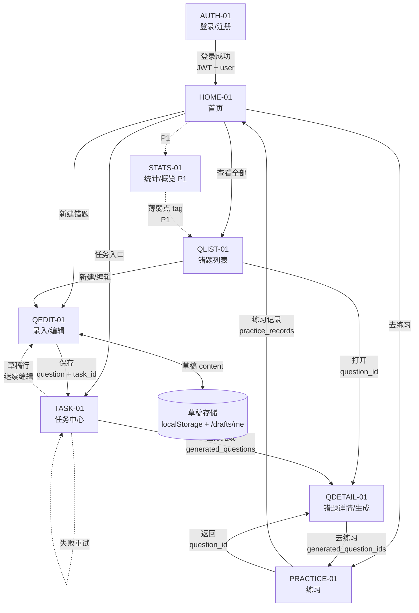
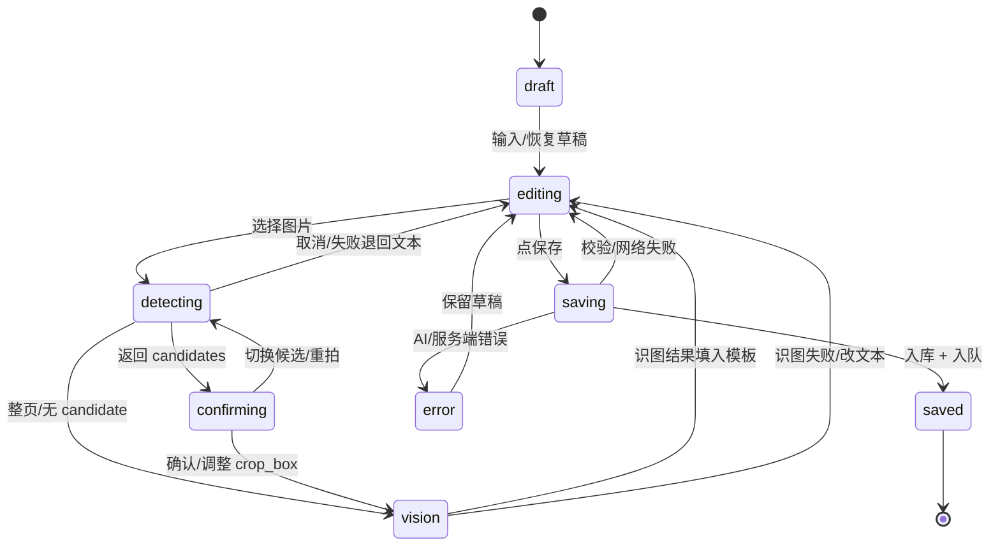
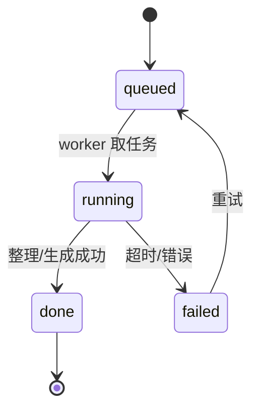
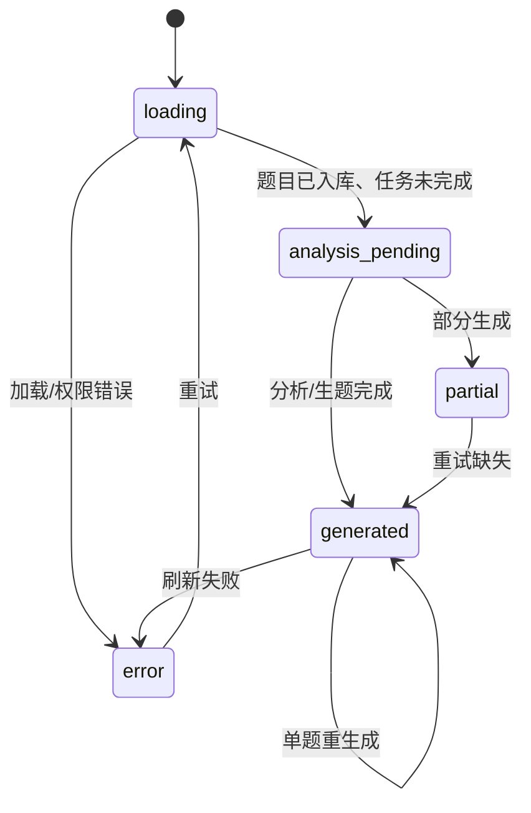
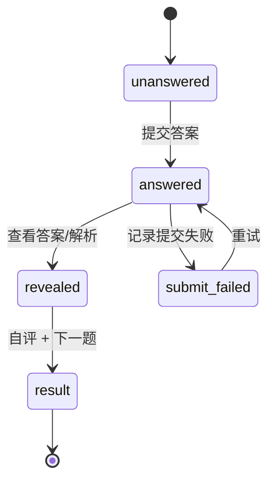

# 08 · 页面交互地图与数据流

> owner: 霹雳马桶 · last_updated: 2026-11-05 · read_when: 前端路由、页面联调、交互评审前
> 配套：`07-page-drafts.md`（线框）、`drafts/prototype.html`（可点击的页面原型）、`drafts/interaction-map.html`（可打开的页面地图，点击页面框可打开原型）。
> 说明：本文只描述**页面/状态/数据流**，不含视觉风格。

## 1. 地图总览



**读图约定**：

- 实线：页面导航。
- 虚线：后台任务/异步状态。
- 点线：草稿/本地存储。
- 粗线（HTML 地图中）：P0 主闭环。
- `P1`：非演示主路径。

## 2. 页面跳转表

| From | 触发 | To | 传递数据 | 优先级 |
|---|---|---|---|---|
| AUTH-01 | 登录/注册成功 | HOME-01 | `access_token`、`user` | P0 |
| AUTH-01 | 已登录访问 | HOME-01 | — | P0 |
| HOME-01 | 点【录入错题】 | QEDIT-01 | 空白编辑器 / 草稿 | P0 |
| HOME-01 | 点【查看全部】 | QLIST-01 | 默认筛选 | P0 |
| HOME-01 | 点任务入口 | TASK-01 | — | P0 |
| HOME-01 | 点【去练习】 | PRACTICE-01 | 可选 `generated_question_id` | P0 |
| HOME-01 | 点统计入口 | STATS-01 | — | P1 |
| QLIST-01 | 点【新建错题】 | QEDIT-01 | 空白编辑器 / 草稿 | P0 |
| QLIST-01 | 点卡片 | QDETAIL-01 | `question_id` | P0 |
| QLIST-01 | 点编辑 | QEDIT-01 | `question_id`、题目内容 | P0 |
| QEDIT-01 | 点【保存】 | TASK-01 / QDETAIL-01 | `question`、`task_id` | P0 |
| QEDIT-01 | 草稿变更 | DRAFT | `content`、`updated_at` | P0 |
| QEDIT-01 | 图片识别 | QEDIT-01 | `candidates`、`bbox`、`crop_box`、`content_md` | P0 |
| TASK-01 | 点任务行 | QDETAIL-01 | `question_id`、任务状态 | P0 |
| TASK-01 | 点失败【重试】 | TASK-01 | `task_id` | P0 |
| TASK-01 | 点草稿行【继续编辑】 | QEDIT-01 | `draft.content` | P0 |
| QDETAIL-01 | 点【去练习】 | PRACTICE-01 | `question_id`、`generated_question_ids` | P0 |
| QDETAIL-01 | 点【重新生成】 | QDETAIL-01 | `generated_question_id`、`target_index` | P0 基础版 |
| PRACTICE-01 | 提交练习 | PRACTICE-01 | `practice_records` | P0 |
| PRACTICE-01 | 完成/返回 | HOME-01 / QDETAIL-01 | 练习结果摘要 / `question_id` | P0 |
| STATS-01 | 点薄弱知识点 | QLIST-01 | `tag` 筛选 | P1 |

## 3. 页面级数据流

| 页面 | 数据流入 | 数据流出 | 主要 API | 关键状态 |
|---|---|---|---|---|
| AUTH-01 | `redirect`、空表单 | `access_token`、`user` | `POST /auth/login`、`POST /auth/register`、`GET /auth/me` | idle / submitting / error / success |
| HOME-01 | `user`、最近错题、最近任务 | 入口选择 | `GET /questions?page=1&page_size=3`、`GET /tasks`、`GET /stats/overview`（P1） | loading / empty / partial / error |
| QLIST-01 | URL filters、`page` | `question_id`、删除请求 | `GET /questions`、`DELETE /questions/{id}` | loading / empty / filter-empty / error |
| QEDIT-01 | `draft`、`image`、`question`（编辑） | `question + task_id`、`draft` | `GET/PUT/DELETE /drafts/me`、`POST /questions`、`POST /questions/from-image` | draft / detecting / confirming / vision / editing / saving / saved / error |
| TASK-01 | `tasks`、`draft` | `retry`、`question_id`、`draft.content` | `GET /tasks`、`POST /tasks/{id}/retry`、`GET /drafts/me` | queued / running / done / failed |
| QDETAIL-01 | `question`、`analysis`、`generated_questions`、`tasks` | `analysis` 更新、`regenerate`、`practice` | `GET /questions/{id}`、`PATCH /questions/{id}`、`POST /generated-questions/{id}/regenerate` | loading / analysis pending / generated / partial / error |
| PRACTICE-01 | `generated_questions`、`question_id` | `practice_records` | `GET /questions/{id}/generated`、`POST /practice-records` | unanswered / answered / revealed / submit failed / result |
| STATS-01 | `overview`、`weak-points`、`trends` | `tag` 筛选 | `GET /stats/overview`、`GET /stats/weak-points`、`GET /stats/trends` | loading / empty / error |

## 4. 状态机

### 4.1 QEDIT-01



### 4.2 TASK-01



### 4.3 QDETAIL-01



### 4.4 PRACTICE-01



## 5. 关键数据对象流

| 数据 | 产生 | 传递/存储 | 消费 |
|---|---|---|---|
| `access_token` / `user` | AUTH-01 | auth store；请求头 `Authorization: Bearer` | 所有受保护页面 |
| `draft.content` | QEDIT-01 | localStorage + `PUT /drafts/me`；`GET /drafts/me` 恢复 | QEDIT-01、TASK-01 草稿行 |
| `image file` | QEDIT-01 | 前端压缩 → 上传；`image_path` | from-image、详情原图 |
| `candidates` / `bbox` / `crop_box` | `POST /questions/from-image` 第一阶段 | 前端高亮 + 移动/缩放/重置；第二阶段回传 `crop_box` | 服务端裁剪、识图 |
| `content_md` / `options` / `blanks` | QEDIT-01 保存 | `POST /questions` → `questions` | QDETAIL-01、PRACTICE-01 |
| `question + task_id` | QEDIT-01 保存 | 响应返回；任务中心查询 | TASK-01、QDETAIL-01 |
| `analysis` | 后台 analysis 任务 | `questions.analysis`；`PATCH /questions/{id}` 可编辑 | QDETAIL-01 |
| `generated_questions` | 后台 quiz 任务 | `generated_questions`；任务完成 | QDETAIL-01、PRACTICE-01 |
| `practice_records` | PRACTICE-01 | `POST /practice-records` | STATS-01（P1） |
| `stats` | 统计接口 | `GET /stats/*` | HOME-01 / STATS-01（P1） |

## 6. 框题确认的数据流（P0）

```text
用户选择图片（电脑粘贴/拖入；手机相册/拍照）
  → 前端压缩：≤5MB / 2000px
  → POST /questions/from-image（第一阶段）
  → { candidates: [{index,bbox,confidence,preview_url}], selected_index }
  → 有 candidate：高亮 top-1
       → 用户确认/切换候选 + 移动/缩放 AI 框 + 重置整图
       → POST /questions/from-image（第二阶段）
          { candidate_index, crop_box? }
       → 服务端按 crop_box 裁剪 → DeepSeek 识图
       → { content_md, answer_md?, question_type, options?, blanks?, ... }
  → 无 candidate / AI 判定整页 / grounding 不可用：
       → 整图识别，不框；结果按题型模板填入编辑器
  → 用户编辑 → 保存
```

**约束**：

- `bbox` / `crop_box` 都是归一化 `[x,y,w,h]`（0–1），基于服务端去 EXIF/旋转后的图。
- 传了 `crop_box` 按它裁；没传按 `candidate_index` 的 bbox。
- 重置整图 = `crop_box: [0,0,1,1]`。
- 从零画框 P1；P0 只调整 AI 给的框。

## 7. 地图文件说明

- `drafts/interaction-map.html`：可双击打开的静态页面地图。
- 线型：实线导航、虚线异步任务、点线草稿、粗线 P0 主闭环。
- 每个连线标签都标注“动作 + 数据”。
- 地图下方有页面数据流表和状态机摘要，便于评审时对照。
