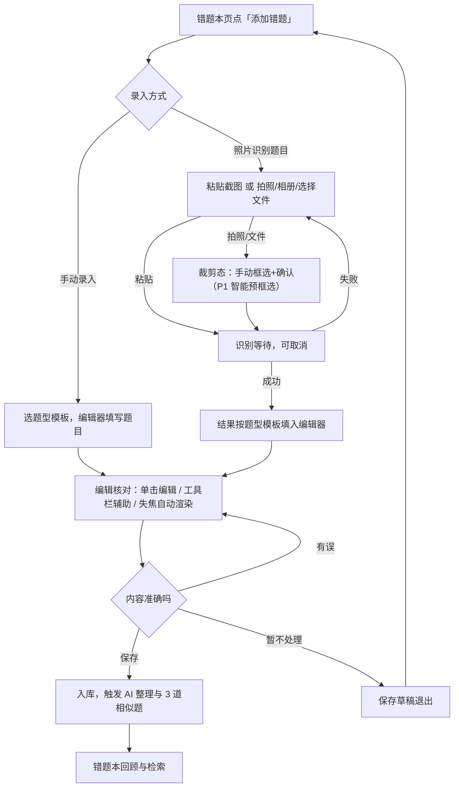
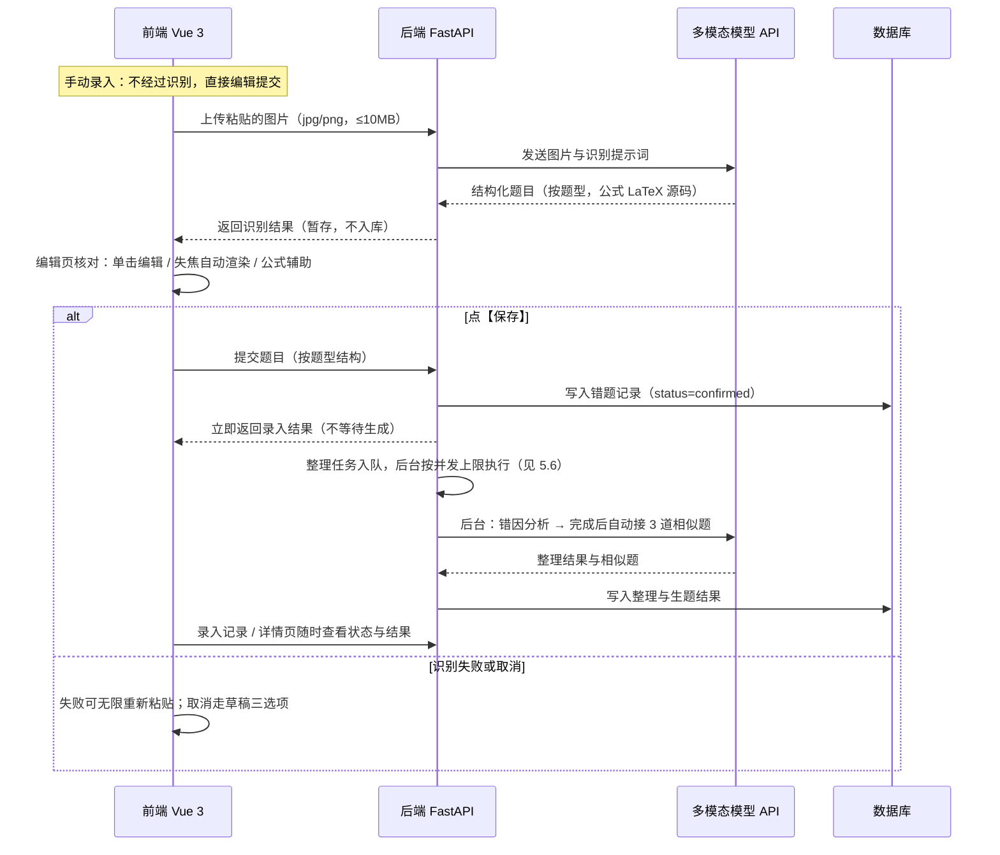

# 巴巴博弈学习机（Bababoi Learning Machine）产品需求文档

> **归档参考，不构成当前契约。** 本文是 2026-11-03 的 PRD v0.8，从 `docs/prd` 分支归档。
> 当前范围/交互/验收以 `docs/product/PRD.md` v0.9（待合并）为准；API/数据/技术以 `docs/agent/05-architecture.md` 为准。
> 原型图已完成参考，后续将独立设计；未归档。

| 项 | 值 |
|---|---|
| 状态 | 归档参考 v0.8（原状态：待团队评审） |
| 日期 | 2026-11-03 |
| 仓库 | https://github.com/plmt3742/Bababoi-Learning-Machine |
| 依据 | 群聊「Achobeta复试进度汇报」当日讨论、共享文档「Achobeta AI错题整理」、大创申报书《基于生成式AI的错题整理系统》、产品评审意见（v0.3/v0.4） |
| 配套 | 《开源项目调研.md》v0.1——11 个参考开源项目与 FR 功能映射 |

本文为契约文档：条目改动需先在群内达成一致，并升级版本号。

标注约定：🔶 假设（合理但未经开发验证，评审时重点过）；🔵 待确认（需指定负责人拍板或待产品与开发讨论）。文中数值指标除明确为用户拍板外，均为产品经理拟定目标值，开发实现前可提出修订。

## 1. 问题陈述与概述

### 1.1 要解决的问题

学生整理错题的现状：手工抄录错题耗时冗长、效率低下；纸质错题本厚重不易携带，无法利用碎片时间回顾；错因与知识点不沉淀，复习时无从下手；想找相似题巩固只能靠题海战术，陷入「只会做这一道题」的困境。

### 1.2 解决方案概述

用户仅需录入错题（手动录入或照片识别），系统便能智能分析并迅速生成三道与原题知识点、题型高度相似的衍生题目，引导学生多维度练习，举一反三，实现从「会做一道题」到「掌握一类题」的提升；错题云端持久化存储，支持分类、标签、搜索与碎片化回顾。

项目为大创申报书《基于生成式AI的错题整理系统》对应方向的实现，申报书仅作功能参考。

| 角色 | 成员（群内昵称） | GitHub | 职责 |
|---|---|---|---|
| 前端 | 霹雳马桶 | Plmt3742 | 前端开发，技术选型评审 |
| 后端 | 人机 | zhouyuliang0606 | 后端开发，技术选型评审 |
| 需求与进度（产品经理） | 我想抓住风的影子 | CooperseaMeteor | PRD 撰写 |

## 2. 目标与非目标

目标：最小可行版本完整跑通「添加错题（手动录入 / 照片识别）→ 编辑核对（LaTeX 渲染）→ 保存入库（整理与 3 道相似题后台生成，不阻塞录入）→ 录入记录与错题本管理」主链路，达到可演示状态。验收标准见第 11 节里程碑。

与申报书功能的对应：

| 申报书功能 | 本 PRD 对应 |
|---|---|
| 错题快速、精准数字化录入（图像识别） | FR-1 / FR-2 / FR-3 |
| 云端错题存储：分类、标签、搜索、随时查阅 | FR-6 / FR-7 |
| 举一反三：智能推送知识点、题型高度相关的相似题（3 道），多维度练习 | FR-5（+ FR-8 复习模式） |
| 错题分析：知识点、题型、易错点多维度分析 | FR-4 |
| 学习进度跟踪：答题时间、正确率、个性化反馈 | FR-10（P2） |

非目标（本期不做，及原因）：

- 自训练公式专项识别模型——已单列为 FR-12（P2），本期用现成多模态与开源 OCR
- 知识图谱构建与自动章节定位——MVP 用人工标签即可
- 用户画像与个性化推荐——无数据积累
- 移动端 App——网页端即可；电脑端录入用系统自带截图 + Ctrl+V 粘贴，不做内嵌裁剪
- 在线画图/绘图题的识别与绘制——题目中的图片支持插入，不支持在系统内作图；绘图类题目后续拓展
- 手写作业批改——场景与识别难度均超出 MVP

## 3. 目标用户与核心场景

目标用户：需要整理错题的学生，不限学段。首期题目内容以文字、公式、表格为主；编辑器支持基础排版：文本、公式（LaTeX）、表格、选项、插入图片。

| 场景 | 描述 | 关键诉求 |
|---|---|---|
| 考后整理 | 考试或作业发还后，将错题录入，生成整理与相似题 | 录入快、识别准、可批量 |
| 期中复习 | 按知识点筛选错题，用相似题自测 | 筛选准、相似题质量 |
| 碎片回顾 | 随时检索错题本，查看错因与知识点 | 检索快、公式显示正常 |

## 4. 功能需求总览

优先级定义：P0 为 MVP 必须，P1 为演示加分项，P2 为远期储备，P3 为探索储备（仅记录方向，不承诺排期）。

| 编号 | 功能 | 优先级 | 说明 |
|---|---|---|---|
| FR-1 | 错题录入 | P0 | 主入口「添加错题」（手动录入）；辅助「照片识别题目」分端路径（P0）：电脑端 Ctrl+V 粘贴截图直接识别（不裁剪）；拍照/相册/文件选择来源必经裁剪步骤——手动框选 + 确认后才上传；jpg/png 单张 ≤10 MB，MVP 单图识别 |
| FR-2 | 题目识别 | P0 | 多模态模型识别，按题型返回结构化题目（见 5.2.2），公式一律 LaTeX 源码；失败判定与处理见 5.4 |
| FR-3 | 人工确认与草稿 | P0 | 识别结果在编辑页核对修改；支持草稿：意外退出自动保存，主动退出弹三选项（见 5.2.4）；确认保存才入库 |
| FR-4 | AI 整理 | P0 | 错因分析、知识点标注，内容可编辑后保存；保存入库后**后台异步执行**，不阻塞录入（见 5.6） |
| FR-5 | AI 生题（举一反三） | P0 | 固定生成 3 道相似题（对齐申报书「举一反三」与预期成果）；整理完成后自动入队后台生成；支持单题重新生成（二次确认）与整组重新生成（见 5.6） |
| FR-6 | 错题本 | P0 | 列表分页（20 条/页🔶）、学科/标签/掌握状态筛选、关键字搜索、详情 |
| FR-7 | 用户账号 | P0 | 用户名+密码注册登录，会话保持 7 天🔶 |
| FR-8 | 复习模式 | P1 | 按知识点出题自测，标记掌握状态 |
| FR-9 | 公式渲染 | P0 | 前端 LaTeX 公式渲染（渲染库采用 KaTeX——在浏览器里把 LaTeX 源码排版成公式的开源 JS 库）；编辑辅助见 5.2.3 |
| FR-10 | 学习统计 | P2 | 录入量、练习正确率、活跃度（对应申报书学习进度跟踪） |
| FR-11 | OCR 兜底按钮 | P1 | 录入页提供 OCR 按钮：接入现成开源 OCR 输出 LaTeX，与多模态结果对比；是否排期以团队后续对齐为准（框架见 4.2） |
| FR-12 | 自训练公式识别模型 | P2 | 专项训练 OCR 模型；FR-11 开源方案效果不足时再评估立项 |
| FR-13 | 可视化公式编辑面板 | P3 | Word 公式编辑器式所见即所得，确定后自动生成 LaTeX 插入（见 5.2.3 L3）；实现成本高，远期探索 |
| FR-14 | 录入记录（任务中心） | P0 | 按录入时间列出每次录入的处理状态（整理/生题：排队中、生成中、完成、失败），可跳转详情、失败重试；顶部置顶未完成草稿入口；即后台生成的日志视图与录入工作台（见 5.6） |
| FR-15 | 智能预裁剪（AI 自动框选） | P1 | 在 P0 裁剪步骤（手动框选）基础上，由模型输出题目区域坐标自动预框选，减少手动操作；依赖模型坐标输出能力（见 7.2），不支持则保持手动裁剪不变 |

### 4.1 识别方案决策记录

识别链路定为：多模态模型识别、人工确认、失败重传；开源 OCR 作为 P1 兜底与对比工具（FR-11），自训练模型为 P2 储备（FR-12）。

决策依据：

- 开源 OCR 识别准确率无法保证，且本产品要求公式以 LaTeX 源码输出，通用 OCR 难以满足；多模态模型直接识图并输出 LaTeX 更契合。
- 错题录入属于零容忍犯错的场景：若识别结果由 AI 直接经手入库，会极大影响用户的错题收集体验，甚至因部分技术原因导致题目永远无法录入。因此识别结果必须经人工确认后才入库。
- 识别失败存在明确的技术信号（接口报错、返回为空、结构化解析失败），据此提示用户重新上传，**不设重试次数上限**；无法机判的内容质量问题（识别结果看似通顺实则错误）由人工确认兜底。

### 4.2 开发期双通道对比实验（FR-11 配套）

选取 10 道典型题目，分别走多模态通道与 OCR 通道，逐题记录：

| 记录项 | 说明 |
|---|---|
| 耗时 | 从提交图片到结果返回的时间 |
| 识别正确率 | 口径 🔵 待定，建议：按「题干文字 / 公式 / 结构（选项与空位）」三部分分别人工判定；文字按语义一致算对，公式按渲染结果与原题数学含义一致算对，结构按选项数、空位数一致算对 |

实验结论用于决定 OCR 兜底按钮的正式排期与 FR-12 是否立项。

> 本节仅定义框架与记录项；实验执行、题目选择与正确率口径由产品经理后续单独立文档与团队对齐，**不阻塞开发排期**。

## 5. 核心流程与录入页交互规范

> 术语说明：识别结果不再单独设「确认页」，统一进入**录入页（编辑器）**核对——手动录入与照片识别共用同一个编辑器，识别结果按题型模板自动填充。

### 5.1 用户工作流

### 5.2 录入页交互规范（FR-1 / FR-2 / FR-3 / FR-9 定稿方案）

#### 5.2.1 入口与图片获取

1. 错题本页常驻【添加错题】按钮 → 进入录入页。
2. 录入页提供两种方式：**手动录入**（默认）与**照片识别题目**（辅助入口，与手动录入并列）。
3. 照片识别按来源分两条路径：
   - **粘贴（电脑端主路径）**：Ctrl+V 粘贴截图 → 直接上传识别，不裁剪（系统截图已框好题）；
   - **拍照 / 相册 / 文件选择（移动端及电脑端选文件）**：选图后进入**裁剪态**——手动框选题目区域，点【确认】后才上传识别；接入智能预裁剪（FR-15，P1）后由模型自动预框选。
   - 粘贴方框提示文案：「Ctrl+V 粘贴图片，或点击选择文件（jpg/png，≤10 MB）」。
4. 前端 1s 内完成格式与大小校验，不合规 toast 提示并停留；进入裁剪态的图片同样先校验后裁剪。
5. 图片上传反馈规范（适用于照片识别粘贴框与题干配图插入，参照常见 AI 聊天上传图片的交互）：
   - 粘贴/选择后 300 ms 内在原位显示缩略图占位与转圈 loading；
   - **粘贴来源**：loading 变为图片缩略图后直接进入识别等待；
   - **拍照/相册/文件来源**：loading 变为缩略图后进入**裁剪态**（见下），确认裁剪后才上传识别；
   - 缩略图右上角悬浮灰色圆形按钮（内黑色 ×），点击即删除该图；照片识别流程中删除同时取消进行中的识别；识别等待全程可删除；
   - 再次粘贴/选择新图 → 替换旧图并重新触发裁剪/识别流程；
   - 校验失败 → 占位处红字提示原因，保留至用户下一次操作。

裁剪态交互（裁剪步骤为 P0，AI 自动预框选为 FR-15/P1）：

1. 进入裁剪态：整图展示，P0 默认框选整图，用户拖拽边框/角点手动框出题目区域，可重置为整图；接入智能预裁剪（P1）后由模型预框选，手动微调不变。
2. 点【确认裁剪】→ 按框选区域裁切原图，进入识别等待；点【取消】→ 放弃该图返回粘贴方框（不弹确认框，图尚未产生内容）。

#### 5.2.2 题型规范（MVP 三种，其他题型后续版本添加）

| 题型 | 结构与规则 |
|---|---|
| 选择题（单选/多选） | 题干 + 选项列表。默认 4 个选项（A–D）；可添加/删除，最少 2 个、最多 24 个（对应 A–Z）；可选选项字母大写或小写；标记单选或多选 |
| 填空题 | 题干中连续三个下划线 `___` 为一个空位，空位数即答案数，上限 20；每个空的答案支持文本与公式（公式 LaTeX 渲染）；「连续 >3 个下划线自动归一为 3 个」为后续增强项（非 P0） |
| 解答题 | 题干一个整体，不单设「第几问」输入框；小问通过排版编号格式表达（见 5.2.3）；作答区自由编辑 |

所有题型均支持在题干中插入配图：点击插入选择本地文件，或直接 Ctrl+V 粘贴（编辑区支持粘贴文本与图片，图片上传反馈见 5.2.1）；不支持系统内绘图。

#### 5.2.3 渲染、编辑与工具栏

渲染与编辑：

- 内容区默认渲染态（LaTeX 公式已排版）；单击内容区进入编辑态（显示源码与结构化字段），渲染隐藏。
- 编辑期间不实时渲染（避免闪烁与光标跳动）；点击内容区以外任意位置（失焦）→ 防抖 400 ms 后自动重渲染。
- 渲染失败有明确技术定义：KaTeX 解析到非法或不支持的命令时会抛出带错误信息与出错位置的异常（如「Undefined control sequence」），不是静默失败 → 前端停留在编辑态，出错公式片段标红并显示该错误信息，内容一律不丢弃。

公式输入分层（按实现难度排期，解决「用户不会 LaTeX」的问题）：

| 层级 | 方式 | 排期 | 说明 |
|---|---|---|---|
| L1 | 识别结果自带 LaTeX，用户在源码上改参数 | P0 | 照片识别流程的主要修改方式 |
| L2 | 工具栏模板按钮：点击插入 LaTeX 片段模板（分数、上下标等），在片段上填参数 | P0 | 手动录入的主要辅助；轻量，实现为「插入代码片段」 |
| L3 | 可视化公式编辑面板：Word 公式编辑器式所见即所得，确定后自动生成 LaTeX 插入 | P3（FR-13） | 面向完全不会 LaTeX 的用户；实现成本高，远期探索，不承诺排期 |

工具栏清单 v1（🔵 待前端评审定稿；能力参考常见教研类软件编辑器）：

| 分组 | 条目 |
|---|---|
| 文本样式 | 加粗、斜体、下划线、删除线 |
| 结构 | 有序/无序列表、表格、插入图片、分割线 |
| 公式模板（LaTeX 片段） | 上标 x²、下标 xₙ、分数 a/b、根号、n 次根、求和 Σ、积分 ∫、极限 lim、绝对值 \|x\|、矩阵、方程组、分段函数、常用希腊字母面板（α β γ θ π ω…）、关系与运算符面板（± × ÷ ≠ ≤ ≥ ≈ ∈ ∞ °） |
| 编号/序号格式 | 圈码 ①②③…、罗马数字 Ⅰ Ⅱ Ⅲ Ⅳ、括号编号 (1)(2)(3)、阿拉伯 1. 2. 3.、字母 a) b) c)、汉字 一、二、三 |
| 编辑操作 | 撤销、重做、清空格式 |

- 工具栏在所有可渲染/可编辑区域可用（类 Word 工具条）；填空题答案、相似题等处同样适用。

#### 5.2.4 按钮与草稿逻辑

按钮组：【保存】（照片识别流程中显示【拍照识别题目】+【取消】+【保存】）。

| 按钮 | 前置条件 | 行为 | 结果 |
|---|---|---|---|
| 保存 | 题干非空；选择题选项 ≥2；填空题每个空位有答案 | 校验后入库 | 触发 AI 整理与生题，跳转详情页 |
| 拍照识别题目 | 录入页任意时刻可用 | 有内容时弹确认框：「当前题目尚未保存，是否继续拍照识别？」选项：取消 / 保存为草稿并继续 / 不保存继续；无内容时直接进入粘贴方框 | 进入照片识别流程 |
| 取消 | 任意 | 弹三选项确认框（见下） | 按所选退出 |

草稿逻辑（服务端账户级 + 本地兜底）：

- 每个账号保留 1 份录入草稿，存服务端（draft 表按 user_id 存取），跨设备可用。
- 自动保存：内容变更后防抖 5 s 同步服务端；同时每次变更实时写入浏览器本地（localStorage）作为断网/未同步兜底。
- **意外退出**（关闭标签页、浏览器崩溃、断网）：本地已有最新内容；恢复登录态后同步服务端。
- **主动退出**（点取消、关闭录入页、切换录入方式）：弹确认框三选项——「取消退出 / 保存为草稿后退出（立即同步服务端） / 直接退出（不保存）」。
- **草稿恢复**：入口两处——进入录入页时自动提示「有未完成的草稿，继续编辑？」；任务中心列表顶部草稿行点击【继续编辑】。恢复时本地与服务端都有则取更新时间较新的一份。

#### 5.2.5 生命周期逐步骤

1. 错题本页点【添加错题】→ 进入录入页，默认手动录入模式。
2. 用户选题型模板（选择题/填空题/解答题）→ 编辑器按模板出字段。
3. 分支 A 手动录入：直接填写题干、选项/空位/作答区，工具栏辅助输入公式与编号。
4. 分支 B 照片识别：点【拍照识别题目】→ 粘贴方框出现 → 粘贴（直接上传）或拍照/选择文件 → 校验 → 文件来源先进入裁剪态（手动框选 +【确认裁剪】，P1 接入后由模型预框选）→ 识别等待态（进度动画 + 已用时计时 + 【取消】）。
5. 识别返回 ≤1s 内按题型模板填充编辑器（题干、选项、空位、设问），公式为 LaTeX 源码，进入渲染态。
6. 用户核对：单击进编辑态 → 工具栏辅助修改 → 失焦防抖 400 ms 自动渲染 → 语法错误标红不丢内容。
7. 用户点【保存】→ 前端校验（5.2.4 前置条件）→ 提交入库（status=confirmed）→ 触发 AI 整理与生题。
8. 提交失败（网络异常）→ 本地暂存已编辑内容，toast 提示重试，不重新识别。
9. 任何时刻点【取消】或离开 → 走 5.2.4 草稿逻辑。
10. 识别失败或超时 → 走 5.4 处理，可无限次重新粘贴。

### 5.3 系统工作流

说明：识别阶段结果只暂存，不写业务库；入库以编辑页【保存】提交为准。

### 5.4 超时与等待策略（v0.6 定稿）

问题：识别与生成都可能因题目复杂而耗时较长；固定短超时会杀掉本可成功的请求，无超时又怕卡死。策略如下：

| 环节 | MVP 策略（P0） |
|---|---|
| 识别 | **同步**（编辑页必须拿到识别结果才能核对）：前端等待上限 **90 s**，超时断开并提示重新粘贴（不限次数）；等待期显示已用时计时与进度动画，可取消 |
| AI 整理 / 生题 | **后台异步队列**（5.6）：保存入库立即返回，整理完成自动接生题，按并发上限排队后台执行，**不阻塞连续录入**；单任务服务端硬超时 **120 s**，失败自动重试 1 次，仍失败可手动重试 |
| 前端等待 | 仅识别有等待态；整理/生题不设前端等待，状态在录入记录与详情页查看 |
| 卡死防护 | 服务端对单任务设硬超时 120 s，超时按失败处理并记录埋点；前端永不无限等待 |

### 5.5 耗时埋点（识别/整理/生题，P0）

目的：量化 90 s 上限是否合理——区分「题目确实要思考很久被掐」与「真实故障/循环卡死」，为上限调整与异步化改造提供数据依据。埋点可以做，随 M1 上线。

每次识别/整理/生题请求记录一条：

| 字段 | 说明 |
|---|---|
| request_id、user_id | 请求标识与用户 |
| stage | recognize / analysis / quiz（识别/整理/生题） |
| question_type、image_size | 题型、图片大小（识别环节） |
| t_submit、t_done | 提交与结束时间戳 |
| duration_ms | 服务端处理耗时 |
| outcome | success / timeout_90s / server_timeout_120s / user_cancel / error |
| retry_index | 该错题第几次尝试 |
| queue_wait_ms | 整理/生题任务从入队到开始执行的排队时长 |
| model_output_tokens 🔶 | 服务端记录模型返回量：超时且输出量持续增长 → 题目确实慢，考虑提上限或异步化；超时且输出接近 0 → 疑似卡死/循环，按故障排查 |

分析指标：成功率、耗时 P50/P90/P99、超时率、取消率、按题型分布、排队时长分布（整理/生题）。为 M2 复盘提供数据。

### 5.6 后台生成与录入记录（FR-4 / FR-5 / FR-14，P0）

设计模式：**异步任务队列**（生产者-消费者）。保存入库后服务端把「整理」任务入队，整理完成自动接续「生题」任务；队列按**并发上限**同时只跑少量任务，其余排队依次消化。类比 AI Agent 的子智能体：主流程（录入）不等任务，后台并行跑，全程有日志可查。

规则：

- 触发：错题保存成功 → 「整理」入队；整理完成 → 「生题」自动入队（生题依赖整理产出的知识点标签）。
- 并发上限：同时执行的模型任务数上限，建议 2–3，具体由后端按模型 API 速率限制（RPM/TPM）与成本核定 🔵；超出上限的任务 FIFO 排队——录多少题都不丢，依次消化。
- 状态机：排队中 → 生成中 → 已完成 / 失败；失败自动重试 1 次，仍失败在录入记录显示【重试】按钮；排队中/生成中的任务不重复入队。
- 重新生成（单题，P0）：每道相似题卡片提供重新生成图标，点击弹二次确认「是否要将第 n 题（n=1/2/3）重新生成？」——确认则作废该题旧结果、单题任务入队，完成后替换该题（其余两道不受影响，生成中状态可见）；取消则无操作。技术评估：复用 5.6 现有队列，仅入队范围不同，无需额外通道，不构成额外复杂度。
- 重新生成（整组）：详情页提供整组重新生成按钮，行为同上但一次入队 3 道，完成后整组替换。
- 结果查看：详情页与录入记录页展示状态与结果；MVP 进入页面/手动刷新拉取，P1 可加未完成角标提醒。

录入记录页（任务中心，FR-14）：

- 列表按录入时间倒序，每行：题目摘要、题型、整理状态、生题状态（含 3 道进度）、录入时间。
- 点击行进入错题详情页；失败行提供【重试】。
- 草稿行：存在未完成录入草稿时，列表顶部置顶显示（题目摘要 + 更新时间 + 【继续编辑】），点击进入录入页恢复草稿；无草稿不显示。
- 定位：既是生成进度看板，也是录入日志与草稿入口——批量录入后可逐条确认消化情况。

## 6. 用户故事与验收标准（开发实现依据）

格式：用户故事 + Given/When/Then 验收标准。验收标准为前端后端联调与 M1/M2 验收的最小依据。

### US-1 添加错题：手动录入与照片识别（FR-1 / FR-2）

作为学生，我想直接添加错题手动录入，也可以粘贴截图让系统识别，省去手抄。

- Given 错题本页，When 点【添加错题】，Then 进入录入页，默认手动模式，可选题型模板。
- Given 手动模式，When 选择题型，Then 编辑器按 5.2.2 出对应字段：选择题默认 4 个选项、可增删（2–24，大小写可选）；填空题以 `___` 标记空位（≤20）；解答题为题干 + 作答区。
- Given 照片识别，When Ctrl+V 粘贴图片，Then 1s 内完成校验并进入识别等待态（计时 + 可取消）。
- Given 拍照/相册/文件选择来源，When 选图，Then 进入裁剪态：手动框选题目区域（P0），【确认裁剪】后才上传识别；接入智能预裁剪后由模型预框选（P1），手动微调保留。
- Given 识别成功，When 结果返回，Then ≤1s 按题型模板填充编辑器，公式为 LaTeX 源码并渲染展示。
- 边界：图片损坏/无法解码 → 按识别失败处理，提示重新粘贴，不设次数上限；MVP 单图识别。
- Given 已有内容，When 点【拍照识别题目】，Then 弹三选项确认框（5.2.4）。

### US-2 编辑核对与草稿（FR-3 / FR-9）

作为学生，我想在编辑页核对修改识别内容（含公式），确认后才入库，且意外关闭不丢内容。

- Given 渲染态，When 单击内容区，Then 进入编辑态；Given 编辑态，When 失焦，Then 防抖 400 ms 自动重渲染。
- Given LaTeX 语法错误，When 渲染，Then 停留编辑态 + 错误定位标红，内容不丢。
- Given 不会 LaTeX，When 使用工具栏公式模板按钮（L2），Then 点选模板填参数即可插入公式；完全不会 LaTeX 的用户在 L3（P3）落地前以修改识别结果或求助模板为主。
- Given 编辑中内容变更，When 停止输入 5 s，Then 自动同步服务端草稿并本地双写。
- Given 编辑中意外关闭标签页，When 重新登录进入录入页，Then 提示恢复草稿（本地与服务端取更新时间较新者）。
- Given 编辑中点【取消】/离开，When 弹窗，Then 三选项：取消退出 / 保存草稿后退出 / 直接退出不保存。
- Given 同一账号已有一份草稿，When 再次保存草稿，Then 覆盖旧草稿（新建录入时已有三选项保护，不静默丢失）。
- Given 校验不通过（题干为空等），When 点【保存】，Then 按钮不可提交并提示原因。

### US-3 AI 整理（FR-4）

作为学生，我想让系统给出错因分析和知识点标注，并且我能修改它们再保存。

- Given 错题保存成功，When 保存返回，Then 立即完成录入（不等待整理），「整理」任务自动入队后台执行。
- Given 整理任务完成，Then 详情页与录入记录展示错因分析（文本）与知识点标签（列表），两者可编辑并保存写回。
- Given 整理任务失败，Then 自动重试 1 次；仍失败在录入记录显示【重试】。
- 边界：识别内容信息不足时，模型输出「信息不足，无法判断错因」，不允许编造🔶。

### US-4 相似题生成（FR-5，举一反三）

作为学生，我想针对错题得到 3 道相似题来举一反三，从「会做一道题」到「掌握一类题」。

- Given 整理完成，Then 「生题」任务自动入队：固定 3 道，与原题同知识点、同题型，题干可含 LaTeX。
- Given 录入记录页，When 查看该错题行，Then 生题状态可见（排队中 / 生成中 / 完成 / 失败）。
- Given 生题完成，When 打开详情页，Then 展示 3 道相似题（编号 1/2/3）。
- Given 单道题卡片，When 点重新生成图标，Then 弹二次确认「是否要将第 n 题重新生成？」；确认后该题转「生成中」，完成后替换该题，其余两道不受影响；取消则无操作。
- Given 点【整组重新生成】，Then 作废旧结果，3 道重新入队，完成后整组替换。
- Given 单道相似题，When 展开答案，Then 显示参考答案与简要思路。
- Given 连续录入多题（如 5 道），When 逐个保存，Then 每道独立入队，超出并发上限的排队等待，最终全部完成、不丢失。

### US-5 错题本（FR-6）

作为学生，我想按学科、标签、掌握状态筛选并搜索错题，快速定位要复习的内容。

- Given 错题本页，When 打开，Then 按录入时间倒序分页展示，20 条/页。
- Given 筛选器，When 选学科/标签/掌握状态（可叠加），Then 列表即时刷新。
- Given 搜索框，When 输入关键字，Then 命中题干与知识点标签并高亮。
- Given 列表项，When 点击，Then 进详情页：原图、题目内容、错因、知识点、相似题入口。
- Given 详情页，When 删除错题，Then 二次确认后删除（含相似题与图片文件）。

### US-6 账号（FR-7）

作为学生，我想注册登录，让我的错题本只有我能看。

- Given 注册页，When 提交用户名+密码，Then 用户名唯一；密码非空且 ≥6 位🔶。
- Given 登录成功，When 7 天内再次访问，Then 免登录；超期重新登录。
- 安全底线：密码只存 hash；错题按用户隔离，接口层校验归属。

### US-7 复习模式（FR-8，P1）

作为学生，我想按知识点抽相似题自测并标记掌握状态。

- Given 复习入口，When 选知识点，Then 随机抽 5 道🔶逐题作答。
- Given 作答后，When 对照答案自评，Then 标记掌握/未掌握，写入 practice_record。

## 7. 技术方案（候选列举，待评审）

> 本节为产品经理依据群内讨论与共享文档整理的候选方案，**仅作列举**。最终选型以前端、后端负责人评审结论为准；评审通过前，本表不构成契约。

| 层 | 候选 | 状态 |
|---|---|---|
| 前端 | Vue 3 + Vite + Arco Design | 🔵 待前端（霹雳马桶）评审确认 |
| 后端 | Python 3.12 + FastAPI | 🔵 待后端（人机）评审确认 |
| 数据库 | SQLite（开发）/ MySQL（生产） | 🔵 待后端评审确认 |
| 公式渲染 | KaTeX（浏览器端 LaTeX 渲染库） | 🔵 待前端评审确认 |
| 模型 | 多模态大语言模型，选型待定 | 🔵 开放问题，按 7.2 约束调研 |
| OCR（FR-11） | 开源 OCR 方案候选（如 RapidLaTeXOCR 等，见《开源项目调研.md》） | 🔵 待后端评审确认 |

### 7.1 与申报书的差异

| 项 | 申报书 | 本项目 | 原因 |
|---|---|---|---|
| 后端语言 | Java + Spring Boot + langchain4j | Python 3.12 + FastAPI（候选） | 团队技术栈匹配 |
| 识别方案 | 图像识别（CRNN + CTC 方向） | 多模态模型直接识图 + 人工确认 | 申报书方案调研于立项前，多模态已成熟且零容忍场景需人工兜底 |
| 题目质量评估 | 教师评审 + 机器评分体系 | 人工确认 + 用户反馈按钮 | MVP 简化，评估体系保留为远期方向 |

### 7.2 模型选型约束

- 支持图像输入的多模态模型
- 输出可包含 LaTeX 公式
- 支持图像区域坐标输出（grounding）者优先——FR-15 智能预裁剪依赖此能力，不支持则该功能退化为手动裁剪
- 提供稳定商用 API，成本可控
- 商用条款允许处理用户上传的题目图片
- 关注服务商速率限制（RPM/TPM）：后台队列并发上限（5.6）须按此核定
- 实现时做 provider 抽象（OpenAI 兼容接口 + 可配置 Base URL / Key / 模型名），不绑死单一服务商；成熟开源项目均如此实现，具体见配套《开源项目调研.md》

候选模型对比另行输出，不列入本文。

## 8. 数据模型草案

| 表 | 关键字段 | 说明 |
|---|---|---|
| user | id、username、password_hash、created_at | 账号 |
| question | id、user_id、question_type（choice/blank/solve）、image_path、content_md、options、blanks、subject、chapter、knowledge_tags、error_reason、status、created_at | 错题主表；content_md 内公式为 LaTeX 源码；options/blanks 按题型结构化存储 |
| generated_quiz | id、question_id、content_md、difficulty、user_feedback、created_at | 相似题 |
| practice_record | id、user_id、quiz_id、result、answered_at | 练习记录，FR-8 启用 |
| draft | id、user_id（唯一）、content、updated_at | 录入草稿，每账号 1 份，逻辑见 5.2.4 |
| generation_task | id、question_id、stage（analysis/quiz）、status（queued/running/done/failed）、retry_index、error、created_at、started_at、finished_at | 后台生成任务队列记录，见 5.6 |

字段命名与类型在接口设计时定稿，本文仅约束概念结构。识别暂存结果不建业务表。

## 9. 非功能需求

| 项 | 要求 |
|---|---|
| 超时与等待 | 识别、整理/生题前端上限 90 s，服务端硬超时 120 s（5.4）；耗时埋点随 M1 上线（5.5） |
| 图片限制 | 单张 10 MB 内，jpg、png |
| 前端渲染 | 识别结果返回后 1s 内完成首屏渲染；编辑防抖 400 ms |
| 列表/搜索响应 | 后端接口 P95 ≤500 ms（开发环境）🔶 |
| 隐私 | 错题图片仅录入用户可见；模型服务商须允许数据处理，条款见选型结论 |
| 浏览器 | Chrome、Edge 现代版本；录入流程以电脑端为主（依赖 Ctrl+V 粘贴），移动浏览器可用（文件选择框原生支持拍照/相册），不做专项优化 |

## 10. 成功指标（MVP）

以现场演示为准：真实题目完整走通「添加错题（两条录入路径各一次）→ 编辑核对 → 保存 → 录入记录查看后台整理与 3 道相似题生成 → 错题本检索」全程无阻断，连续录入多题不被后台生成阻塞；公式渲染正确；草稿退出-恢复可用。量化目标（演示后统计）：识别一次通过率 ≥60%🔶（口径见 4.2 对比实验）、录入内容入库成功率 100%。

## 11. 里程碑与节奏

进度汇报节奏：每 4 天在群内更新一次，同步写入共享文档开发日志。

| 里程碑 | 内容 | 验收 |
|---|---|---|
| M1 | 手动录入 + 照片识别 + 编辑核对 + 入库链路前后端联调 | 真实题目图片完整走通，5.2 各分支（含草稿）可用，5.5 耗时埋点上线 |
| M2 | AI 整理与生题后台队列、录入记录（任务中心）、错题本可用 | 现场演示完整流程（第 10 节指标）；连续录入 ≥5 道全程不被后台生成阻塞 |
| M3 | 复习模式、OCR 兜底按钮（FR-11）与整体打磨 | 达到复试演示标准 |

具体日期由团队按复试时间倒排，本文不预设。

## 12. 开放问题

| 事项 | 负责人 | 途径 |
|---|---|---|
| 技术选型评审（第 7 节） | 霹雳马桶、人机 | 群内评审，结论回填第 7 节 |
| 工具栏清单 v1 定稿（5.2.3，产品已拟初版） | 前端 | 评审后回填定稿 |
| 后台队列并发上限数值（5.6，建议 2–3） | 后端 | 按模型 API 速率限制与成本核定 |
| 双通道对比实验执行与正确率口径（4.2） | 产品（我想抓住风的影子） | 产品后续单独立文档对齐，不阻塞开发 |
| 多模态模型选型 | 全员 | 按 7.2 约束调研候选，群内拍板 |
| 生产环境 MySQL 部署位置 | 人机 | 确认可用服务器资源后定 |
| 演示用种子题目集 | 我想抓住风的影子 | 收集典型错题图片，M1 联调用 |

## 13. 变更记录

| 版本 | 日期 | 变更 |
|---|---|---|
| v0.1 | 2026-11-03 | 初稿，依据当日群内讨论与共享文档整理 |
| v0.2 | 2026-11-03 | 增加配套《开源项目调研.md》引用；7.2 补充 provider 抽象的行业惯例 |
| v0.3 | 2026-11-03 | 按产品评审意见重写：放宽目标用户；新增确认页交互规范；技术方案标注待评审；新增用户故事与验收标准 |
| v0.4 | 2026-11-03 | 按产品评审意见修订：概述精简；职责改为 PRD 撰写；补充申报书功能对应表（明确举一反三=FR-5）；目标用户与编辑器能力重述；新增题型规范（选择 2–24 项/填空 ≤20 空/解答编号格式）与公式辅助输入；录入入口重构（添加错题为主、照片识别为辅、Ctrl+V 粘贴、无裁剪）；新增草稿逻辑（意外自动存、主动退出三选项）；重试不设上限；超时策略独立成 5.4（同步/异步两方案待拍板）；FR-11 上调 P1 并拆出 FR-12；4.2 新增双通道对比实验 |
| v0.5 | 2026-11-03 | 按产品拍板修订：5.4 超时定稿（识别与整理/生题前端上限 90 s，服务端硬超时 120 s，异步化列为后续优化）；新增 5.5 耗时埋点设计（区分慢题与卡死/循环，随 M1 上线）；公式输入分层（L1 识别自带/L2 模板按钮 P0/L3 可视化面板降 P3 记为 FR-13）；工具栏清单 v1 拟定待前端评审；4.2 对比实验改为不阻塞开发、产品后续单独立文档；草稿改为服务端账户级 + 本地兜底（draft 表、防抖 5 s 同步、恢复取较新） |
| v0.6 | 2026-11-03 | 生题与整理改为后台异步队列（产品拍板）：保存入库立即返回不阻塞连续录入，整理完成自动接生题，按并发上限排队执行（5.6）；新增 FR-14 录入记录（任务中心）作为生成进度与录入日志；5.4 超时策略相应修订（仅识别同步 90 s）；数据模型新增 generation_task 表；埋点新增排队时长字段；US-3/US-4 验收改写；M2 验收新增「连续录入 ≥5 道不被阻塞」 |
| v0.7 | 2026-11-03 | 按产品评审意见修订：配图支持 Ctrl+V 粘贴（编辑区可粘贴文本与图片）；新增图片上传反馈规范（占位转圈 → 等比缩略图 → 右上角 × 删除，识别中可删，重贴重识别）；渲染失败明确定义（KaTeX 解析异常含错误信息与位置，非静默失败）；相似题重新生成改为单题为主（卡片图标 + 二次确认「是否要将第 n 题重新生成」，复用现有队列无额外通道）并保留整组重新生成；草稿并入任务中心（列表顶部置顶草稿行 + 继续编辑，草稿不单独成模块） |
| v0.8 | 2026-11-04 | 按群内讨论与开发方案定稿：照片识别按来源分端——电脑端 Ctrl+V 粘贴直接识别（P0，不裁剪），拍照/相册/文件选择必经裁剪步骤（P0，手动框选 + 确认后才上传，交互见 5.2.1 裁剪态）；新增 FR-15 智能预裁剪（P1，AI 自动框选，依赖 7.2 模型坐标输出能力，不支持则保持手动裁剪）；7.2 选型约束增加「支持图像区域坐标输出者优先」；5.1 流程图、5.2.1/5.2.5、US-1 验收同步 |
